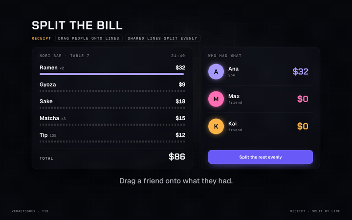

# Split the Bill

**Drag your friends onto what they ate.**



**Live demo:** [veraetogrex-portfolio.github.io/split-bill](https://veraetogrex-portfolio.github.io/split-bill/) · **Mockup:** [full-screen version](https://veraetogrex-portfolio.github.io/split-bill/mockup/split-bill.html)

Drag a person onto a receipt line: the line's bar splits between everyone on it and each person's total recounts. "Split the rest evenly" assigns what's left, and the totals turn into Pay buttons.

## Use it

Three files, no build step, no dependencies, no web fonts:

```
index.html   markup
style.css    styles and keyframes
script.js    behaviour
```

Download the repo and open `index.html`, or copy the three files into your project.

## Try it

- Drag Max or Kai onto any line; drag more people onto the same line to share it.
- Press "Split the rest evenly" to finish the bill.

## Make it yours

`PEOPLE`, `PRICES` and `START` at the top of `script.js` set who's at the table, what was ordered and who already took what.

## What's in `mockup/`

The full 1440×900 screen this component was shot in for the reel:

- `mockup/split-bill.html` — interactive. `D` plays the demo, `R` resets.
- `mockup/split-bill.autoplay.html` — the scripted loop the reel was recorded from.
- URL flags: `?frame` puts the screen in a browser window, `?clean` hides the control panel, `?once` plays the demo once.

The mockup loads the same `style.css` and `script.js` from the root, plus a shared stage runtime and bundled fonts from `mockup/_shared/`. The component in the root doesn't need any of it.

---

Component 18 of a series. New one every day on Instagram [@veraetogrex_portfolio](https://www.instagram.com/veraetogrex_portfolio/) · all components: [github.com/veraetogrex-portfolio](https://github.com/veraetogrex-portfolio)

MIT licensed.
